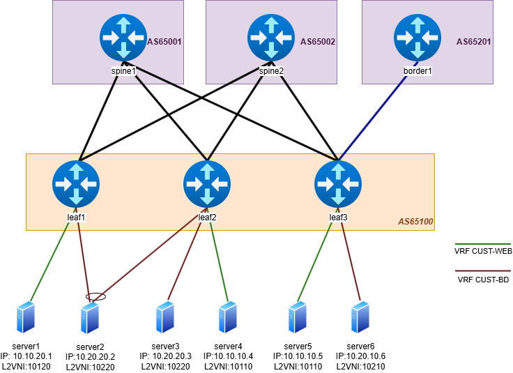

# Топология тестовой сети (Containerlab + FRR)

Схема ниже показывает связность leaf/spine, VRF, BGP‑соседства и принадлежность сервера к L2VNI:

## Пояснения к схеме

- Зелёные линии - означают, что клиент в VRF CUST-WEB.
- Бардовые линии - означают, что клиент в VRF CUST-BD.
- Синии линии - означают выход в Интернет.
- L2VNI подписаны рядом с клиентскими устройствами.
- Светло-жёлтая область (прямоугольник) означает, что устройство находится в iBGP-домене.
- Фиолетовая область (прямоугольник) означает что устройство имеет собственную ASN.

## План адресации

### Loopback (router-id, BGP peering)

| Хост       | Loopback0      | Роль         |
|:-----------|:---------------|:-------------|
| spine1     | 10.0.0.11/32   | Spine, AS65001 |
| spine2     | 10.0.0.12/32   | Spine, AS65002 |
| leaf1      | 10.0.0.21/32   | Leaf, AS65100  |
| leaf2      | 10.0.0.22/32   | Leaf, AS65100  |
| leaf3      | 10.0.0.23/32   | Leaf, AS65100  |
| leaf4      | 10.0.0.24/32   | Leaf, AS65100  |

Соглашение:
- IP loopback для spine = 10.0.0.Х, где X = 10 + N, N - номер spine  
- IP loopback для leaf = 10.0.0.X, где X = 20 + N, N - номер leaf 

### Transit networks (point-to-point, /31)

| Линк                   | Сеть            | Порт leaf | Порт spine |
|:-----------------------|:----------------|:----------|:-----------|
| leaf1 <-> spine1       | 10.1.1.0/31     | eth1      | eth1       |
| leaf1 <-> spine2       | 10.2.1.0/31     | eth2      | eth1       |
| leaf2 <-> spine1       | 10.1.2.0/31     | eth1      | eth2       |
| leaf2 <-> spine2       | 10.2.2.0/31     | eth2      | eth2       |
| leaf3 <-> spine1       | 10.1.3.0/31     | eth1      | eth3       |
| leaf3 <-> spine2       | 10.2.3.0/31     | eth2      | eth3       |

Соглашение: 
Транзитная подсеть формата 10.Y.Z.0/31, где 
 - Y номер spine;
 - Z номер leaf;
 - IP c окончанием ".0" всегда на spine, ".1" всегда на leaf.

### External gateway

| Линк                 | Сеть            | Порт leaf | Порт border |
|:---------------------|:----------------|:----------|:------------|
| leaf3 <-> border1    | 80.4.0.0/31     | eth3      | eth1        |

## VRF / VNI

| VRF       | VNI (L3) | VNI (L2) | Подсеть         | Шлюз (Anycast)   | Описание            |
|:----------|:---------|:---------|:----------------|:-----------------|:--------------------|
| CUST-WEB  | 50010    | 10110    | 10.10.10.0/24   | 10.10.10.254     | WEB-фермы           |
| CUST-WEB  | 50010    | 10120    | 10.10.20.0/24   | 10.10.20.254     | WEB-фермы           |
| CUST-BD   | 50020    | 10210    | 10.20.10.0/24   | 10.20.10.254     | Lossless трафик     |
| CUST-BD   | 50020    | 10220    | 10.20.20.0/24   | 10.20.20.254     | Lossless трафик     |

## VNI MAC/RT/RD

| VNI (L2/l3) | Устройство         | MAC-адрес         | RT(auto)     | RD(auto)        |
|:------------| :------------------|:------------------:--------------:-----------------|
| 10120       | leaf1              | 44:00:00:01:01:20 | 65100:10120  | 10.0.0.21:10120 |
| 10220       | leaf1              | 44:00:00:01:02:20 | 65100:10220  | 10.0.0.21:10220 |
| 10220       | leaf2              | 44:00:00:01:02:20 | 65100:10220  | 10.0.0.22:10220 |
| 10110       | leaf2              | 44:00:00:01:01:10 | 65100:10110  | 10.0.0.22:10110 |
| 10110       | leaf3              | 44:00:00:01:01:10 | 65100:10110  | 10.0.0.23:10110 |
| 10210       | leaf3              | 44:00:00:01:02:10 | 65100:10210  | 10.0.0.23:10210 |
| 50010       | leaf1,leaf2,leaf3  | 44:00:00:05:00:10 | 65100:50010  | 65100:50010     |
| 50020       | leaf1,leaf2,leaf3  | 44:00:00:05:00:20 | 65100:50020  | 65100:50020     |

Формат для MAC L2/L3 VNI: 44:00:00:0X:XX:XX, где последние 5 символов - номер VNI

## MGMT

Все leaf/spine подключены отдельным mgmt-портом к коммутатору агрегации, через который осуществляется управление.

| Хост       | IP управления  | 
|:-----------|:---------------|
| spine1     | 192.168.99.11  |
| spine2     | 192.168.99.12  |
| leaf1      | 192.168.99.21  |
| leaf2      | 192.168.99.22  |
| leaf3      | 192.168.99.23  |

Соглашение: 
- IP управления для spine = 192.168.99.X, где X = 10 + N, N - номер spine  
- IP управления для leaf = 192.168.99.X, где X = 20 + N, N - номер leaf  

